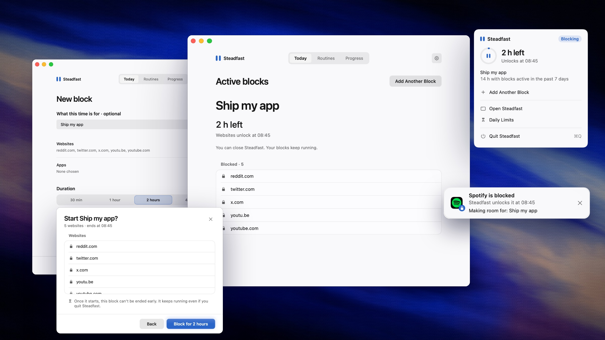
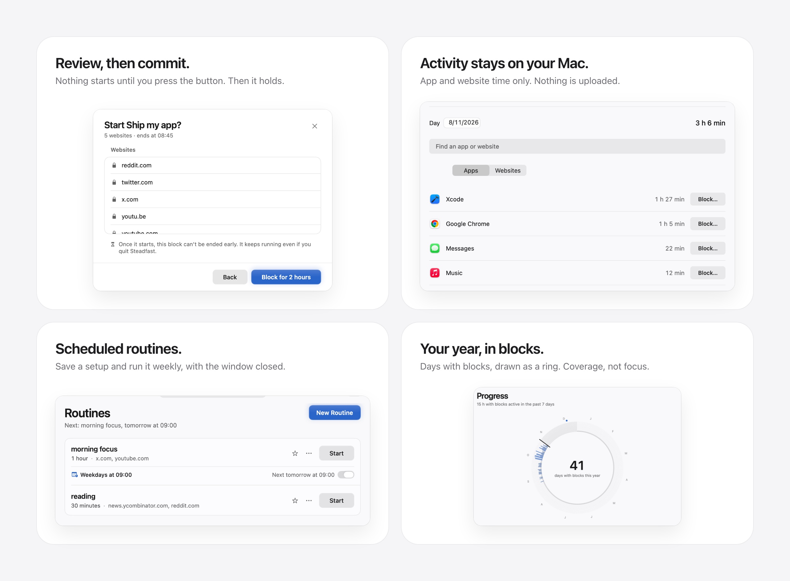

# steadfast

A native macOS app built with Swift 6.4, SwiftUI, AppKit Liquid Glass, BSD UDP sockets, Network.framework TCP, and XPC. Choose distracting websites and Mac apps, then commit to a timed block. Websites are blocked across browsers through the Mac's system resolver; apps are closed as soon as they start.



Watch the launch film at **[steadfast.kartikkabadi.com](https://steadfast.kartikkabadi.com)**.

## install

Steadfast needs an Apple silicon Mac with macOS 26 or later. Run:

```sh
curl -fsSL https://github.com/kartikkabadi/steadfast/releases/latest/download/install.sh | /bin/bash
```

The installer verifies the download and asks for administrator access to install a background service. The official release uses a self-signed certificate and is not notarized by Apple. The command runs the downloaded installer immediately; review `scripts/install.sh` first if you prefer.

## use steadfast

Open `/Applications/Steadfast.app`. The app has three pages:

- **today:** your aim and the last useful setup, ready to review again. **new block** opens a draft with an optional purpose, website and app choices, and a duration. only the final **block for …** button starts blocking. during a block, your purpose and unlock times stay in view; the full blocked list is below them. closing the window leaves blocks running.
- **routines:** save choices and a duration for reuse or a weekly schedule. **start** opens the same commitment review. favorites appear on today and in the menu bar. editing a routine changes future starts and never shortens an active block.
- **progress:** the year as a ring of recorded days with blocks. inspect a day with the mouse, arrow keys, Home or End. time with blocks active includes night hours, merges overlaps, and excludes browser diagnostics. it does not measure attention, time saved, or work completed. history keeps up to 200 completed blocks plus active blocks. expand a past block to see its choices, times, saved feedback, or save it as a routine. **use again** opens a fresh review.



After a block finishes, today offers **did your last block help?** for up to seven days. answer, add an optional note, or skip. answers stay on this Mac and can be seen with the block in progress. there is no streak or overdue reflection.

The first opening has a short welcome, an optional purpose, local activity history, distraction choices, and a duration. it needs no past usage history or account. app and website history share one switch, on by default; websites need macos access. no apps or categories are selected automatically. every commitment has the normal review. setup stays in the normal window. welcome and activity setup show clearly labeled examples; they never start blocks or create history. a browser check is available before the first commitment; it tests only the current browser and configuration.

A routine can repeat weekly for up to 24 hours. scheduled blocks start with the window closed. after sleep or a service restart, an ongoing scheduled window resumes for its remaining time; completely missed windows are skipped. schedules use the Mac's current time zone. the routine menu can skip or restore one future run. overlapping schedules keep a target blocked until its latest applicable end time.

**settings** holds your aim, optional local usage tally, service status, browser check, daily limits, routine sync, and uninstall. **browser check** tests example.com during a real one-minute block in the default browser. it appears in history but does not count as block coverage. a healthy service alone does not establish that every browser or network configuration will block websites.

The menu bar shows current unlock times, the next routine, and shortcuts to review saved choices. **quit** closes the client; the separate background service continues blocks and schedules. with no active blocks or enabled schedules, the healthy service releases its process and stays available on demand.

To uninstall, turn off schedules, let active blocks finish, and remove exhausted daily limits or wait for midnight. uninstall removes the app and local policy after administrator approval.

Keyboard shortcuts: command-1/2/3 switch pages, command-N opens a block draft, command-shift-N creates a routine, command-F opens website search, and command-comma opens settings. command-return confirms review or saves a routine. Escape leaves a sheet without starting a block.

Steadfast requires an Apple Silicon Mac running macOS 26 or later. the terminal installer verifies the release before asking for administrator approval. blocks, routines, daily limits, and history carry over when you update. the beta uses a project-owned release certificate and needs no Apple Developer account or certificate installation on the user's Mac. no account or analytics is required.

## preview the experience safely

Run `./scripts/preview.sh` to open the real app with separate preferences and a disposable background service. the preview can create and expire commitments through real XPC, but it never changes system DNS or closes real apps. a visible preview label makes that scope clear. quit the preview with command-Q to remove its service and temporary files. the installed app and its policies are not touched.

## commitments

Choose from fourteen preset categories or enter domains yourself. Presets include both `x.com` and `twitter.com`. Selected domains include subdomains. A block can last from one minute to 365 days. Blocks over 24 hours require confirming the full end date. The service validates every commitment and refuses overlapping replacements. Active commitments have no edit, delete, shorten, or pause operation.

## your aim and time tally

**settings → your aim** holds what you want more room for, its optional deadline and an optional private reason for making a change. The aim, private reason and feedback live in `~/Library/Application Support/Steadfast/outcomes.json`. They stay local. An optional purpose entered for an individual block uses its existing name field in the service policy; the global aim and private reason never reach the service.

**progress → activity** keeps active app and website time on this mac. **save activity on this mac** is on by default and controls both. **allow website access** requests macos permission to read the active browser's domain. app time works without that permission. app names, domains, durations, and recent activity intervals are stored locally and are never uploaded. it stores no screenshots, page titles, full addresses, or page contents. private tabs can be included; pause history when you want them off the record. there is no import dependency or backfill before recording starts.

apps and websites have separate totals, because website time is already part of browser time. choose a day, search apps or domains, inspect recent activity, or select **block…** to prepare a block through the normal review. daily totals stay for 400 days. the recent timeline stays for 30 days, capped at 20,000 entries. **delete activity history** removes both. stopping recording keeps existing history. quitting Steadfast stops recording; closing its window leaves the menu app running.

the tracker samples every five seconds while the Mac is awake and has had input in the past minute. sleep, lock, user switching, and long sampling gaps are excluded. website support depends on a browser exposing its active URL through Accessibility; unsupported or unreadable browsers keep app time and show a clear status. the collector only reads browser URL metadata, never a browser's stored history.

## daily website limits

Set a per-site budget under **settings → daily limits**. After you add a limit, the block page and menu bar show its status and link to the full list. With Accessibility permission, Steadfast samples the foreground browser's web area. It counts matching domains while the app is running, the display is awake, and the Mac has seen input within one minute. Support depends on whether the browser exposes the active page's domain through accessibility. Only the configured domain and sampled time are recorded locally. A reached limit uses the same DNS rules as timed blocks until local midnight, including when the app quits.

## app blocking

Add apps to any block or routine, alone or alongside websites. The picker groups installed apps into chat & social, games, video & music, browsers, news & reading, AI tools and other apps, using known bundle identifiers and each app's declared App Store category. iPhone and iPad apps installed on the Mac are included. Menu bar helpers are left out of the list, but **choose another app…** accepts any app bundle.

While an app is blocked, the root service watches process launches with kqueue: every process is observed for fork, exec and exit, so a launch from the Dock, Finder, Spotlight or `open` is stopped at exec, before the app's own code runs. A one-second sweep of the process table backs that up. Apps are matched by bundle identifier, so a renamed or moved copy is still blocked, and helper apps inside an app's bundle close with it. Only an app's own programs count: the executable in `Contents/MacOS`, or at the root of an iPhone or iPad app. Command-line tools that ship inside a bundle keep working, so blocking Xcode never breaks `git` or `clang`. Nothing running from the operating system's own locations (`/System/Library`, the OS cryptex, `/usr`, `/bin`, `/sbin`, `/Library/Apple`) is ever closed, whatever rule is in the policy. Before closing a process the service checks that its ID still names the same process, by start time, so a reused process ID is never hit. Fork bursts, such as a build, are coalesced into at most one scan every 15 ms on a strict timer. Bundle files are read without following a final symlink or blocking on a pipe. With no app blocks the watcher closes completely and costs nothing.

An app that is already open when its block starts gets ten seconds. The menu bar app asks it to quit the normal way, so it can offer to save, and shows a countdown. After ten seconds the service closes whatever is left. Later launches are stopped immediately and a small notice says what was blocked and until when. If Steadfast isn't running, the service opens it in the background as the signed-in user, without a window, at most three times an hour. An app that the service closes more than three times in two minutes is relaunching itself, for example as a login item, so its notices pause for ten minutes. Any process can post the app's change notification, so the app collapses bursts into one authenticated status request at a time; notice text always comes from the service. App names are cleaned of control and bidirectional formatting characters.

Finder, the Dock, System Settings, Terminal, Activity Monitor, security and login components, and Steadfast itself can never be blocked. Terminal stays available because Steadfast's updater and uninstaller run in it.

This needs no Apple-issued entitlement. Apple's Endpoint Security and Screen Time APIs could deny a launch before it happens, but both require a paid developer account and Apple's approval. The limits are the same as for websites: an administrator can stop the service, and an app copied and re-signed under a different bundle identifier is no longer recognized.

## routine sync

Choose the same private shared folder on each Mac under **settings → routine sync**. Steadfast writes the routine names, domains, apps, durations and revision records into a `Steadfast Routines` subfolder. It checks for changes while the app is running. The shared-folder provider handles transport. Schedules, skips, active blocks, daily limits, and history stay local. If an incoming edit or deletion would change an enabled schedule, Steadfast asks you to turn off that schedule before it can apply the changes. Disconnecting leaves the shared files in the folder.

The window app is a client. Commitments and enforcement live in a separate service, so closing or deleting the app leaves them in place. Quitting the client releases its memory and leaves the service in charge of commitments. launchd starts the service at boot, restarts it after a failure, and keeps its Mach endpoint available for on-demand requests. Once every commitment has expired, no schedules are enabled, and DNS cleanup succeeds, the service exits normally after ten quiet seconds. Active commitments, enabled schedules and enforcement errors keep it running. A monotonic clock and persisted timestamps resist clock rollback while running; administrator clock changes are not securely prevented across reboots.

At expiry the service removes its own resolver files and hosts entries, preserving unrelated configuration. Normal uninstall refuses while a commitment is active or a schedule is enabled. When every commitment has expired, run `/Applications/Steadfast.app/Contents/Resources/Uninstall.command`.

## what this enforces

For selected domains, the service creates scoped `/etc/resolver` files pointing to its localhost DNS listener. It answers blocked queries with NXDOMAIN over UDP and TCP, including IPv4, IPv6, and HTTPS-record requests. It also adds IPv4 and IPv6 hosts entries for each selected domain and its `www` name. DNS cache flushes run only when configuration changes.

Blocked apps are closed with `SIGKILL` at launch, after the open-app grace period described under app blocking. The service never closes processes outside app bundles, protected system components, or itself.

This is a DNS blocker, not a packet filter. Browsers or apps using encrypted DNS, VPN-provided DNS, cached addresses, existing connections, alternate domains, or direct IP connections may bypass it. It cannot be impossible for the computer's administrator to stop or remove. Stronger enforcement requires a managed account or a signed Network Extension and suitable device policy.

The daemon listens only on `127.0.0.1`, not the LAN. UDP uses a single nonblocking datagram socket with bounded read batches; TCP uses Network.framework. Reused UDP client sockets do not create or close per-query server sessions. The app uses local XPC rather than an HTTP server. The installer verifies each update against the original designated signing requirement, then pins that verified executable's exact code hash for Swift XPC authorization using a lightweight process requirement before message handling. Both pins and rules are root-owned. This avoids repeated certificate-chain checks on new connections while restricting clients to the installed build. No analytics, browsing-history collection, remote API, or network forwarding is included. The optional time tally keeps only local per-day totals.

The app reuses its authenticated XPC session. Cold service connections have a sixty-second safety deadline; later requests time out after five seconds. Failed connections reconnect on the next request without replaying commitments. Successful requests cancel their timeout tasks. The active UI subscribes to system change notifications and fetches authenticated status when rules or enforcement change. Healthy status has no polling timer; disconnected or unhealthy status retries every ten seconds. If notification registration fails, a thirty-second poll preserves status updates. Inactive windows stop observing and retrying. With no active commitments and healthy enforcement, the service leaves memory after the quiet grace period. Active commitments keep a checkpoint at most sixty seconds apart and an expiry timer. Adaptive launchd scheduling lets XPC activity receive suitable priority. DNS blocking uses a domain index instead of scanning every rule on each query.

## installed files

- `/Applications/Steadfast.app`
- `/Library/PrivilegedHelperTools/dev.local.steadfastd`
- `/Library/LaunchDaemons/dev.local.steadfast.service.plist`
- `/Library/Application Support/Steadfast/` with the policy, original signing requirement, installed-build runtime requirement, and service log
- only the service's marked sections in `/etc/hosts` and its marked files in `/etc/resolver`

Steadfast checks the configured release feed when you open the app or menu bar, at most once per day unless you check manually. When an update is available, Settings opens the signed bundle's installer in Terminal after confirmation. You can also run the terminal installer directly. Updates preserve the existing policy and original client signing requirement. The installer validates the new app against that requirement, restarts the service only when its files change, and restores the previous installation if an update fails. It checks production XPC health as your regular user before reporting success.

## build and check

For development, install Xcode with a Swift 6.3 or newer toolchain and run `swift build`. This compiles the app and helper without the official release key. Run `./scripts/preview.sh` for an isolated preview. Official packages require the release signing identity.

```sh
./scripts/package.sh
/bin/bash dist/release/install.sh --local dist/release --verify-only
./scripts/check-experience.sh
./scripts/check-activity.sh --interactive
python3 scripts/test-live.py
python3 scripts/test-routines-live.py
python3 scripts/test-advanced-live.py
python3 scripts/test-apps-live.py
./scripts/check-ui.sh --width 640 --height 600 --state routines --output /tmp/steadfast-ui.png
python3 scripts/check-lifecycle.py
```

For an optional production check, run `python3 scripts/test-production.py --from-ui`. After its baseline is ready, create a one-minute `example.com` block through the app. The check observes DNS and HTTPS until the block expires. It refuses to start if that domain is already actively blocked.

There are no third-party dependencies. Disposable test executables and state live in the system temporary directory, outside Documents, so the helper does not request Documents access. The app blocking live test launches throwaway app bundles from the sandboxed service's own folder and checks the grace period, relaunch stop times under 50 ms, helpers, renamed copies, command-line tools inside a blocked bundle, protected apps, a planted pipe, a burst of 1,000 processes, and expiry. In sandbox mode the service only ever closes executables inside that folder, so real apps are never touched. The live test temporarily launches an unprivileged service, exercises real XPC and localhost UDP/TCP DNS, kills and restarts that service, waits for a real one-minute commitment to expire, and removes its temporary launchd job and data. It never changes system DNS. The benchmark compares the reference policy scan and indexed lookup under the same optimized compiler settings; it measures rule lookup, not network latency or overall app speed.

The experience check drives the real app model against a disposable XPC service: setup, review, commit, real expiry, reflection storage, repeat, cancellation, errors and progress presentation. It checks old local outcome-file compatibility and leaves system DNS unchanged.

The UI check renders the real SwiftUI root offscreen and exports its content as a PNG without screen-recording permission. Use `--light` for light appearance and `--state` with `empty`, `empty-aim`, `returning`, `reflection`, `selected`, `selected-apps`, `review`, `review-apps`, `review-long`, `websites`, `apps`, `active`, `active-aim`, `active-many`, `active-offline`, `active-error`, `active-apps`, `active-apps-only`, `routines`, `routines-empty`, `routine-editor`, `routine-editor-apps`, `history`, `progress`, `progress-empty`, `progress-noaim`, `ring-day`, `ring-deadline`, `onboarding`, `onboarding-aim`, `onboarding-activity`, `onboarding-blocklist`, `onboarding-start`, `onboarding-install`, `settings`, `settings-outcomes`, `settings-aim-edit`, `settings-tally`, `activity`, `activity-paused`, `activity-empty`, `notice-closing`, `notice-blocked-aim`, `notice-blocked-cost`, or `browser-check` for fixture states, and `--interactive` to show and keep the window open. It requires an isolated test-service name and never connects to the installed service. Fixtures do not create real blocks.

The signing key lives in the dedicated Steadfast signing keychain. Back it up along with its password, stored under `steadfast-signing-keychain` in the login keychain. Keep the key private. The checked-in certificate fingerprint is public and must match the keychain's signing identity. Replacing that identity breaks updates.

For a local install, omit `--verify-only` from the command above. If this Mac has an older test build signed with Apple Development, use that build's uninstaller first. It refuses to remove the service while a block or enabled schedule remains. There is no signer migration.

To prepare a release, run `./scripts/package.sh` and attach every file in `dist/release/` to the same GitHub release before publishing it. Test the installer on a clean Mac with default security settings, then install a second signed release and verify updates and existing commitments.

## design

The app reuses Cedar's neutral palette, typography, focus rings and button primitives with the owner's authorization. Browser theme plumbing is omitted and shared state is adapted for Swift 6. See `CEDAR-TEMPLATE.md` for the original source mapping and `LICENSE-Search` for the upstream notice. Steadfast has its own royal-blue accent. Cedar's repository remains unchanged. Native controls retain keyboard and accessibility behavior, and colors support light, dark and increased-contrast appearances.

The workspace uses plain rows and separators with a neutral background, system typography, and rounded blue primary buttons. The website picker, routine editor, settings and final confirmation use native sheets. Lists scroll while service status stays visible. Custom duration supports minutes, hours and days. Disconnected and unhealthy service states preserve last-known commitments without claiming current protection.

## administrator recovery

If the window app is deleted, restore the same built app to `/Applications/Steadfast.app`; commitments remain in the separate service. If the service cannot start, inspect `/Library/Application Support/Steadfast/service.log` and `launchctl print system/dev.local.steadfast.service` as an administrator. A DNS-port conflict, corrupt policy, or filesystem failure is reported rather than resetting commitments.

For emergency recovery, an administrator can boot out the named launchd job, remove only files beginning with `# managed by steadfast dns` from `/etc/resolver`, remove only the `# BEGIN STEADFAST DNS` through `# END STEADFAST DNS` section from `/etc/hosts`, and flush the DNS cache. Preserve all unrelated resolver and hosts entries. This recovery route is intentionally documented; this software does not attempt to defeat the computer owner.

## launch film and website

`launch/` holds the launch film (Remotion), the website, and the scripts behind the screenshots and the collages above. Every screen in them comes from the real app. See [launch/README.md](launch/README.md).

## license

Steadfast is available under the [MIT license](LICENSE). The retained [Search license](LICENSE-Search) applies to its reused components.
